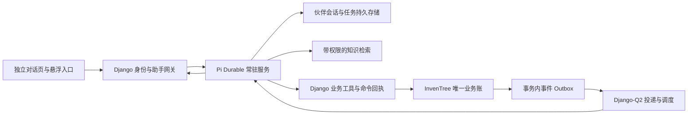

# 仓序工作伙伴：技术规划与实施交接

日期：2026-10-13。状态：已推进 S2 模型业务工具、常驻底座与 assistant-ui 对话附件开发，实际文件与证据见[实施记录](ASSISTANT-IMPLEMENTATION.zh-CN.md)；未在记录中列为已实现的模块、对象与 API 仍为拟定设计。

先读 [AGENTS.md](../../AGENTS.md)、[业务需求基线](REQUIREMENTS.zh-CN.md)、[产品规划](ASSISTANT-PRODUCT.zh-CN.md)，再实施本文。产品的简洁独立对话页与后台常驻工作为已确认方向；具体工具权限、生产模型及业务未决规则须按第 13 节落实。

2026-10-13 UI 实施决定：采用 `@assistant-ui/react` 的外部存储运行时适配 Django/Pi 持久会话；不另建浏览器内模型调用。附件经已登录 API 私有上传与下载，消息仅引用服务端 UUID，Pi 通过内部伙伴身份读取受限内容。支持图片与 PDF/DOCX/XLSX/CSV/TSV/文本资料；不支持的格式明确拒绝。文档提取与图片能力状态必须可见，不能把上传成功等同于识别成功。具体限制、文件实现与验证结果以实施记录为准。

## 1. 核对依据与当前基础

本次代码阅读基线：`f8016e9d44567418e67c9b0e9449e49db91bdc6e`。接手 agent 必须重新检查分支、未提交改动和当前实现，不能把本次阅读当作部署或现场证据。

| 现有入口 | 用途与接入边界 |
|---|---|
| [router.tsx](../../src/frontend/src/router.tsx) | 新增受登录保护的独立助手路由 |
| [Layout.tsx](../../src/frontend/src/components/nav/Layout.tsx)、[MainMenu.tsx](../../src/frontend/src/components/nav/MainMenu.tsx) | 全站入口与导航；不改变业务表单焦点 |
| [CangxuHome.tsx](../../src/frontend/src/pages/cangxu/CangxuHome.tsx) | 已有业务导航、追溯搜索和表单入口 |
| [IncomingReceiptPanel.tsx](../../src/frontend/src/pages/cangxu/IncomingReceiptPanel.tsx) | 复用收货、验收、异常处置与附件交互的业务语义 |
| [MaterialIssuePanel.tsx](../../src/frontend/src/pages/cangxu/MaterialIssuePanel.tsx)、[ShipmentReceiptPanel.tsx](../../src/frontend/src/pages/sales/ShipmentReceiptPanel.tsx) | 后续领退料、签收接入参考 |
| [cangxu/api.py](../../src/backend/InvenTree/cangxu/api.py)、[models.py](../../src/backend/InvenTree/cangxu/models.py) | 收货、验收、处置、领退料、维修和签收等实际业务入口；逐项检查权限、事务与幂等 |
| [CONTRIBUTING.md](../../CONTRIBUTING.md) | Django-Q2 后台任务、Mantine、Lingui、TanStack Query、测试及迁移约定 |

Pi Durable 官方资料在 2026-10-13 通过宿主机 `gh` 读取，并固定参考提交 `7d75a0e3eb273dff753d49c066ea29fbe7b3b6f6` 的 [README](https://github.com/earendil-works/pi/blob/7d75a0e3eb273dff753d49c066ea29fbe7b3b6f6/packages/durable/README.md)。这是调研依据，不是已安装或已验证的依赖版本。Context7 本次检索失败，技术依据使用官方仓库原文。

已核对的框架边界：

- `Harness.open()` 配合持久化 storage；`resume()` 可恢复未完成任务。
- 相同 `requestId` 避免重复接收同一 submission，不保证外部业务副作用恰好一次。
- 工具只有声明 `replay: "safe"` 才在相应中断后重放；外部副作用仍需自己的幂等策略。
- 后台 ownership 与前台 run 分离；取消当前等待不等于停止工作，普通 abort 也不等于停止全部后台任务。
- 一个 storage 同时只能由一个进程持有，框架没有跨进程锁。
- Node SQLite 适合长驻持久任务，但默认 WAL / `synchronous = NORMAL` 对进程崩溃与主机掉电的保证不同。
- 框架 API 仍为实验性。锁定发布版本与锁文件，升级先验证存储、恢复、工具和流协议兼容性。

上述能力不提供仓序的事件采集、业务定时职责、用户授权或库存事务；这些由宿主集成实现。Pi 的输出事件流也不等于业务事件总线。

## 2. 架构决定

首期建议独立 Node/TypeScript 常驻服务，与现有 Django 服务部署在可互通的受控网络内。运行环境和最终主机在实施前确定，不默认改动现有生产服务。前端只通过受认证的应用入口访问，模型凭据不下发浏览器。

职责划分：

- **Django**：用户、角色、业务权限、授权记录、业务事务、操作回执、事件与定时计划的权威。
- **Pi Durable**：对话内容、推理与工具执行过程、任务 checkpoint、工作记忆引用与前端流状态的权威。
- **知识索引**：可重建的检索副本；不保存第二套库存，不直接定义业务批准规则。
- **前端**：展示已持久化的消息，提交意图及业务引用。浏览器 timer 不承担调度，localStorage 不承担业务状态。

同一事实只设一个写入权威。Django 可保存 run ID、对象关联与可重建的状态投影用于授权/检索，但不另写一份竞争性的任务计划。Pi 不能只凭自己的 checkpoint 判断库存写入成功，必须依据 Django 回执。

## 3. 伙伴、身份与授权

### 3.1 隔离与职责归属

默认每个部署实例、每名用户一个伙伴实例，以内部 ID 关联一个主对话及后台任务；storage 路径由服务端生成，不能接受用户路径。不同部署、用户、附件、记忆和检索上下文隔离。首期不开放多人共享同一个可写对话。

长期职责记录主体、对象范围、动作集合、约束、交办来源、版本、有效期或明确的持续状态、撤销状态；短期模型命令直接沿用当前用户权限，回执只记录执行意图与结果，不要求独立授权对象。grant 是后台执行凭据，不是用户逐工具配置流程：网关依据自然语言交办自动登记该次任务范围，常驻职责设定一次后复用；不增加重复授权弹窗、计划批准或恢复时的再次确认。必要歧义在对应步骤澄清，其他独立工作继续。用户未登录时已授权工作可继续；用户禁用、权限撤回、职责撤销或服务被停用后停止新动作。注销与撤销是不同语义，不依赖浏览器 cookie 维持后台工作。

多人对同一对象交办时，后端业务锁与动作前置条件仍是最终防线。对具有排他性的长期写职责建立唯一归属/冲突检查，不能只在“同一会话”内去重。

### 3.2 服务到业务 API 的身份

浏览器使用现有会话/认证机制，写请求保留 CSRF 等既有防护。网关核对身份后才路由到指定伙伴；不能信任客户端传来的 `user_id`、伙伴 ID 或对象权限声明。

Pi 使用独立、可撤销的服务身份调用内部工具入口；Django 根据服务端伙伴绑定解析当前用户；模型工具复用原业务 API 的权限，持续职责另保留交办来源和对象过滤范围，不允许一个模型参数冒充任意用户。建议短期、限定 audience 的内部凭证或等效受控服务认证；具体实现先做安全集成验证。

每次读取、写入、恢复及附件访问均检查当前用户的原业务权限；模型工具不要求额外 grant。持续职责的范围记录只约束该长期任务，不变成逐步授权 UI。审计同时记录实际业务操作者、代理服务、授权 ID、任务 ID、原因与变更前后值；不能以管理员共享 token 代替用户权限。

权限不足返回结构化业务错误；权限撤回立即使未执行写入失效。即使模型声称“用户已批准”，也必须核对后端授权记录。

## 4. 持久化对象与数据所有权

以下为概念对象，可按实际 Django 结构合并或拆分；不得重复实现已有业务实体。

| 对象 | 所有者 | 最小内容与约束 |
|---|---|---|
| PartnerBinding | Django | 部署/用户/伙伴/主对话映射、启停状态；唯一绑定 |
| AssistantGrant | Django | 用户、对象范围、动作、数量限制、版本、有效期、撤销、授权证据 |
| AssistantDuty | Django | 持续目标、grant、触发过滤、检查周期/时区、游标、暂停状态；变更有版本 |
| AssistantCommand | Django | 命令键、规范化请求哈希、对象、grant/run/step、执行状态、结果引用；同键异参拒绝 |
| AssistantOutboxEvent | Django | 稳定事件 ID、对象类型/ID、版本、事件种类、时间、关联命令、投递状态 |
| AssistantInboxReceipt | Pi 持久存储 | 事件/命令投递 ID、接收状态、submission ID；跨重试去重 |
| WorkRun / WaitCondition | Pi 持久存储 | 目标、业务引用、grant 版本、任务 checkpoint、依赖条件、结果、期限与预算 |
| KnowledgeDocumentRevision | 知识管理后端 | 来源、版本、状态、ACL、校验摘要、发布时间与替代关系 |
| MemoryEntry | Pi / 受控记忆服务 | 用户范围、内容、来源、确认时间、有效期、删除状态；不得存批准结论或库存真值 |
| ReadCursor / NotificationReceipt | Django 或明确单一持久实现 | 用户阅读位置、消息去重键、事件版本；不同设备一致 |

消息正文以 Pi 为权威，Django 仅保存必要投影与读取控制。附加业务文档优先复用已有附件体系，聊天临时附件与正式归档附件明确区分。删除聊天附件不会自动删除已依法或依制度归档的业务记录，保留策略需明确。

## 5. 事件与定时驱动

### 5.1 业务事件的可靠投递

业务事务提交时，在同一事务写入 outbox。后台通过现有 Django-Q2 发送最小事件元数据；只有下游确认持久接收后才标记投递成功。`transaction.on_commit()` 可用于唤醒投递器，不能作为唯一可靠事件存储。

至少一次投递，接收端以稳定事件 ID 去重。事件 payload 尽量只含对象引用与版本，执行时重新查业务事实，不信任过期快照中的可用库存。重试采用退避，达到上限进入可诊断的失败状态；修复后可重新投递而不重复业务效果。

首期审计所有相关写入口：仓序 API、原生采购/附件入口、后台操作都可能改变状态。不能只监听助手自己执行的操作。无法直接覆盖的入口通过基于稳定游标/对象版本的对账扫描补足；扫描覆盖范围和延迟需列入验收。

恢复启动后先恢复持久任务，再补投未确认事件，并查询等待对象的最新状态。乱序或重复事件不使任务状态倒退。记录 causation/correlation ID，合并同一对象变化；防止助手写入触发自身无限检查与重复通知。

### 5.2 定时职责与等待条件

调度计划持久化，使用现有 Django-Q2 调度设施或与其一致的持久实现，不另建浏览器轮询调度。每个到期时段产生稳定投递键，例如 `duty_id + scheduled_at + revision`；多调度进程必须安全抢占或唯一入列。

扫描周期是配置项。开发验收可使用短周期；生产频率由业务时效与成本确定。调度使用明确时区，默认业务时区 Asia/Shanghai。服务停机后按职责策略合并补查，不把每个错过的时间片全部重复执行。

外部业务等待以持久的对象条件及补查计划表示，不能只在内存里等待 Promise。Pi 等待子任务与“等待仓管明天签字”不是同一个现成机制；后者由业务事件/补查恢复。等待期间释放计算资源，不持续调用模型。

## 6. 业务工具与执行一致性

### 6.1 工具边界

优先定义有限且类型明确的领域工具：知识检索、对象查询、收货准备/执行、验收记录查询、附件关联、领退料、签收登记、操作回执查询。每个工具登记 schema、所需权限、允许的 grant 动作、前置条件、幂等规则、结果格式、重放策略和启用状态。

第一版不向模型提供任意 shell、SQL、HTTP、管理员 token 或通用“更新任意模型字段”工具。常规业务通过现有服务逻辑执行；需要抽取事务服务时同时供原 API 与助手工具复用，避免规则分叉。

推荐结果格式包含 `status`、业务对象引用、回执 ID、实际数量/状态、待补字段或冲突原因；模型不得把工具 error 文本总结为成功。已有 API 基础不等于允许开放，必须完成专门的权限、幂等与恢复验证。

### 6.2 写入、超时与恢复协议

1. 根据用户命令或有效 duty 建立持久 run，固定业务对象与授权版本。
2. 读取当前业务事实，构造规范化动作；必要信息不足时进入持久等待。
3. 在工具执行前持久保存稳定 `command_id` 与请求哈希。恢复或模型重试不得为同一次逻辑动作生成新命令键。
4. Django 在业务事务内重新检查原业务权限、对象状态及期望版本，取得所需行锁；持续职责另外检查其尚未撤回的范围记录，短期模型命令不经过 grant 前置层。
5. 执行原生业务变更，同时保存命令回执与 outbox。相同键相同请求返回原结果，相同键不同请求返回冲突。
6. Pi 保存工具结果，必要时回查对象，并生成已持久化的用户消息。

`requestId` 去重输入，`command_id` 去重副作用，领域约束处理不同用户/命令竞争同一业务对象。三者均需要，不能互相替代。没有现成对象版本字段时，应在事务中验证等价的状态/数量条件或补版本机制，不能假装现有 API 已支持乐观锁。

超时不等于失败：先按原命令 ID 查询回执。查到成功则续接；查到明确拒绝则报告；结果未知时保留 `reconciling` 状态并补查，禁止换键盲重试。只有端到端证明安全的工具才声明 replay safe；未证明的外部写操作中断后进入核实。

文件上传等非数据库副作用采用先暂存、校验摘要、再在事务内关联的流程；使用稳定上传键防重，并清理孤儿文件。跨系统无法一个事务覆盖时使用持久分步与正式补偿动作，不能宣称全链路原子回滚。

### 6.3 停止与并发

“停止生成回复”“停止这项工作”“暂停这项持续职责”“停止全部自主写入”映射到不同的持久控制命令，均支持重试。普通关闭页面不发送 abort。

停止先撤销/冻结相应执行资格，再取消 Pi 对应任务；工具在提交前检查资格。已经提交的业务事务仍如实报告，停止不抹去历史。不直接把所有停止操作映射为普通 `root.abort()`，后台 ownership 必须纳入控制范围。

同一用户对话输入需要有序接收；独立后台任务可限量并行。竞争同一对象的写入由 Django 约束裁决。子任务不得扩大 grant，不默认采用多个 agent 自由互相派发任务。

## 7. 知识、记忆与资料治理

建立版本化流程目录，至少涵盖需求基线的全部业务域。每个条目关联流程编号、角色、步骤/分支、页面、支持状态、来源和维护人。规划、演示资料、草稿、正式批准资料具有不同状态；不能全量把仓库 Markdown 当作正式 SOP。

业务编号、SN、订单号使用精确查询；语义检索用于说明、流程和手册。初期可使用经过评测的关键词/全文检索，语义索引按效果需要补充；向量库选型不阻塞业务服务。候选 pgvector 只用于可选知识索引，不改变上游基础仓管的数据库可移植性。

检索前按部署/用户/资料 ACL 过滤，返回后、生成引用及打开附件时再次校验。更新、撤回、删除要使旧索引失效；模型缓存和记忆不能继续提供已撤权资料。记录来源版本和检索时间，无正式依据时说明未知并给出可执行的人工处理路径。

长对话通过摘要与按需历史检索控制上下文。摘要不是授权证据，不能替代命令回执或正式业务事实。用户可查看、更正、删除个人偏好；删除后要使摘要和派生记忆失效，审计/业务记录依既定保留规则处理。

附件、网页、业务备注及检索内容均视为资料；其中的“忽略规则、代替用户批准”等文本不能修改工具权限。模型仅接收任务必要的数据；模型服务的数据处理边界在生产接入前确定。

## 8. 对外协议与前端集成

以下路由均为拟定契约，实施时需输出 DRF schema 及事件协议版本。

| 拟定接口 | 行为 |
|---|---|
| `GET /api/cangxu/assistant/` | 当前用户伙伴绑定、真实可用状态与必要配置 |
| `POST /api/cangxu/assistant/messages/` | `client_request_id`、文本、附件 ID、明确业务引用；持久接收后返回 message/submission ID |
| `GET /api/cangxu/assistant/messages/` | 有界分页历史、引用与读取权限过滤 |
| `GET /api/cangxu/assistant/stream/` | 已认证的持久状态快照及增量；仅服务端持久化后展示 |
| `POST /api/cangxu/assistant/controls/` | 明确作用范围的暂停/停止/继续；带幂等键 |
| `GET /api/cangxu/assistant/operations/{id}/` | 按需展开实际回执及已生效/未生效部分 |
| `GET/POST /api/cangxu/assistant/grants/` | 查询与登记范围明确的授权；撤销/修订须有独立动作及版本校验 |
| `GET/POST /api/cangxu/assistant/memories/` | 查询、新增明确偏好；更正/删除采用受控动作 |
| `POST /api/cangxu/assistant/read-cursor/` | 保存阅读位置，后台消息可形成未读提示 |

业务工具、事件投递与调度接口仅面向经过认证的内部服务，不能暴露为匿名入口。附件上传复用现有附件能力或增加受限暂存入口，不让客户端指定任意文件路径。

前端消息提交与接收分离：提交获得持久接收回执，流断开不取消任务。首期推荐同源 SSE；需先验证现有部署代理、认证与 Django 服务模式对长连接的支持，不成立时采用认证 WebSocket 或有界拉取，同样保持“快照 + 游标”语义。

网络重连获取当前已提交快照，再接增量；消息/帧使用稳定 ID 去重，不能承诺恢复每个 token 的原始事件。多标签页重发同一请求只受理一次。权限撤回后断开相应流并清除受限前端缓存。需要保留草稿，但不能把敏感正文无期限存入浏览器。

建议新增前端目录 `src/frontend/src/pages/assistant/` 与 `components/assistant/`；沿用 Mantine、Lingui、TanStack Query 与现有导航/认证约定。任务状态只用于消息内轻量反馈和按需详情，不默认渲染侧栏、职责区、任务列表或管理仪表盘。

“在线”由后端 worker 心跳与最后成功调度时间判定，不能只凭浏览器连上网关。状态可简化为可用、处理中、暂不可用；详细监控属于运维。流式文字不能逐 token 打断屏幕阅读器；滚动时不强制跳底。

## 9. 部署、恢复与运行限制

- 首期每个 storage 单进程持有，持久卷不可随容器销毁；采用明确的进程监管和启动恢复。禁止两个副本同时打开同一 SQLite 文件，不能靠负载均衡掩盖存储所有权问题。
- 启动顺序包括迁移兼容检查、注册同版本工具/任务、打开 storage、恢复 pending work、接收新事件。升级前备份并验证旧任务恢复，保留回退方案。
- Pi SQLite、Django 数据库、附件和知识版本记录协同备份；恢复后先对账命令回执和 outbox，再开放自动写入。单独还原旧 Pi 状态不能导致已完成业务重放。
- 进程崩溃、主机掉电与整机恢复分别验证。不能把默认 SQLite 进程恢复保证描述成零数据丢失或高可用；具体 RPO/RTO 与部署方案在试点前确定。
- 限制并发 run、单次工具耗时、模型轮次、每日费用、重试次数与附件大小。超限持久暂停并提示，避免自主循环消耗。
- 对话正文与真实附件不进入常规应用日志。运维记录事件 ID、run/command ID、延迟、失败原因和费用汇总；监测调度滞后、失败投递与等待积压。
- AI 服务断开、模型限流或凭据不可用时，原业务服务继续运行；恢复采用退避，不伪报在线或成功。

## 10. 首期工具开放清单

| 工具组 | 第一版要求 | 开放前证据 |
|---|---|---|
| 网站/流程知识、对象导航 | 可用且有来源/版本；未知支持状态明示 | 全流程目录、问题集、过期资料与权限测试 |
| 采购/收货/验收/附件查询 | 精确对象定位，保留部分收货及分支语义 | 当前 API 与附件权限验证 |
| 入库归档跟进 | 事件 + 定时补查 + 等待恢复；真实附件关联等授权写入 | IN-01～IN-06 各分支及幂等回执测试 |
| 收货、检验、处置动作 | 按已实现且验收通过的动作开放 | 不代签、不编造检验，默认可用/可选隔离/异常隔离，单步审批 |
| 耗材领退料、签收差异 | 后续优先接入；不阻塞首条常驻职责验证 | MAT、OUT 的数量守恒、重放、权限和隔离联调 |
| 放行、盘点调整、导入落账等 | 条件未满足时只解释或准备 | 对应业务规则及验收完成后独立启用 |

## 11. 接手 agent 的实施顺序

2026-10-13 用户最新指令调整 S2 内部优先级：先接现有业务 API 的模型查询/执行工具与真实完整链路，再补网站/流程知识。工具直接复用当前登录用户及原业务权限，不继续加授权层；MCP 可作为后续相同工具契约的暴露方式，不必为接入 MCP 复制业务规则。当前采用 Pi typed tools → Django 原 API 的受控桥接，未声称已经提供 MCP server。

以下阶段是内部开发顺序；S1 或 S2 完成不等于产品第一版交付。S0/S1 已启动，实际进展及剩余项以实施记录为准，其余阶段仍待实现、待验证。

| 阶段 | 具体工作与交付物 | 退出条件 |
|---|---|---|
| S0：核对与选型 | 检查当前工作区；锁定 Pi/Node 兼容版本；确定部署、模型、用户绑定及首条职责范围；记录 ADR | 用虚构任务证明持久提交、无浏览器运行、重启恢复与背景停止；实验不接生产数据 |
| S1：模型与迁移 | grant、命令回执、outbox、职责/调度及关联模型；Pi 持久文档与状态迁移方案 | 唯一约束、权限、迁移/恢复检查通过，不新增库存余额 |
| S2：API/事务与运行时 | 身份网关、工具层、稳定命令键、事件投递、定时补查、恢复、预算、知识检索 | 重复/乱序/撤权/超时及至少一条真实业务写路径通过 |
| S3：虚构数据端到端 | 用合成采购、附件、验收与签字状态跑完整职责，注入重启与响应丢失 | 无聊天、无浏览器时自主处理；操作回执与实际数据库一致 |
| S4：中文 UI 与交互 | 独立简洁对话、悬浮入口、引用/附件、重连、历史、必要操作消息 | 登录型真实 API 浏览器测试通过；没有回到被否定的工作看板形态 |
| S5：试点交付 | 补知识缺口、角色与设备测试、备份恢复、限额、部署手册与现场验收 | 业务负责人确认；本地、CI、隔离与现场证据分别记录 |

建议代码组织：独立服务目录候选 `src/assistant/`，Django 行业模块下按功能拆助手模型/API/服务，避免继续向单一大文件堆积所有逻辑。路径可按仓库实际规范细化；新依赖、schema、迁移、运行配置和恢复说明须随实现提交。

开发检查遵守 CONTRIBUTING：后端定向测试使用 `--keepdb`，迁移测试按其例外规则运行；前端完成类型检查、构建、翻译和必要的 Playwright；新 API 生成 schema 并审阅差异。不要把本文中的拟定名字直接当成现有命令或接口调用。

每阶段更新需求追踪表，列出实现文件、测试命令、结果和剩余业务缺口；按照仓库约定在实现与必要检查就绪后开 PR，不提交 AI 生成 Issue。不得提交真实客户、SN、人员、凭据或原始企业资料。

## 12. 验收场景与证据

以下用例初始状态全部为“待执行”。测试使用虚构身份与业务数据。自动化通过不代替现场业务验收。

| 用例 | 对应需求 | 必须证明 |
|---|---|---|
| AI-AC-01 简洁入口 | AI-01 | 独立单列对话；悬浮入口指向同一伙伴；默认无任务/职责看板；不抢扫码焦点 |
| AI-AC-02 离线期间工作 | AI-02、AI-03 | 关闭全部浏览器且不发消息，业务事件与独立定时检查分别触发真实工作，结果持久保留 |
| AI-AC-03 跨天与重启 | AI-02、AI-04 | 等待签字/附件后重启，资料补齐后续接原任务；不要求用户重复交办 |
| AI-AC-04 响应丢失 | AI-07 | 业务事务已提交而 Pi 未收到结果时杀进程；恢复查回执，无重复收货/关联 |
| AI-AC-05 多入口与乱序 | AI-03、AI-07 | 原生页面/仓序接口产生的变化均可发现；重复、乱序、停机补查不重复执行或通知 |
| AI-AC-06 授权与撤回 | AI-08 | 离线工作使用有效 grant；禁用用户、撤权、过期或超范围时后端拒绝；跨用户及附件读取隔离 |
| AI-AC-07 真实人工动作 | AI-07、AI-08 | 不代验货/签字；来料单步审批，无逐级会签；缺证据不伪报归档完成 |
| AI-AC-08 停止语义 | AI-09 | 停回复、停任务、停职责、停全部写入各自有效且跨重启保留；如实显示已生效步骤 |
| AI-AC-09 知识与能力边界 | AI-05、AI-06 | 全流程目录可查；旧资料撤回生效；未知规则/未实现功能明示；实时库存不从向量记忆猜测 |
| AI-AC-10 注入与泄漏 | AI-05、AI-08 | 附件/备注中的指令不能越权、外发或改变批准状态；正文、附件与检索不跨用户泄漏 |
| AI-AC-11 安静工作 | AI-10 | 相同状态重复检查不刷屏；有实际结果/失败/人工动作才发消息；多标签/重连无重复未读 |
| AI-AC-12 记忆管理 | AI-11 | 确认偏好后可用、更正后更新、删除后派生摘要也失效；业务审计不被当作偏好误删 |
| AI-AC-13 并发冲突 | AI-07 | 两人争用同一库存只允许合法一次生效；不同命令键也不能绕过数量/对象约束 |
| AI-AC-14 故障与预算 | AI-12 | 模型限流、凭据失效、超预算、重试上限时明确暂停；业务页面继续可用 |
| AI-AC-15 备份与升级 | AI-04、AI-12 | Pi/业务库/附件恢复与回执对账；版本升级后旧任务恢复；分别记录进程崩溃与主机恢复结果 |
| AI-AC-16 现场连续协作 | AI-01～AI-12 | 操作员交办→离开→后台推进→返回接续→回查业务结果；确认简洁界面与人工责任边界 |

每个结果记录：代码/依赖版本、数据集、环境、执行命令/人工步骤、预期与实际、业务回执、必要的脱敏截图或日志，以及失败项。禁止以“模型回答正确”替代数据库与权限结果核对。

## 13. 决策与交接状态

| 项目 | 当前决定或实施前处理要求 |
|---|---|
| 产品形态 | 已确认：简洁独立连续对话 + 右下角入口；无首页工作分区、任务看板或默认多栏 |
| 运行机制 | 已确认：Pi Durable 常驻，主动触发与恢复首期具备；不依赖用户聊天 |
| 库存与来料规则 | 按既有基线执行：仓序唯一库存账，来料单步处置；不得再次猜测或新增审批链 |
| 部署与依赖 | 推荐受控网络内独立 Node 服务；接手 agent 锁定可用版本、主机、持久卷和恢复方案后再部署 |
| 模型与数据边界 | 已确认使用用户提供的自部署 OpenAI 兼容端点做测试，初选 GLM-5.3-Flash；凭据仅存本地忽略配置，供应商、地址和模型可配置；费用金额不设上限，保留轮次/重试/并发限制。当前只发送虚构测试内容；生产资料范围仍待确定 |
| 首期职责与写权限 | 推荐入库归档跟进；实际用户/仓区/单据范围、自动写动作及持续授权需登记，不默认全仓权限 |
| 知识负责人 | SOP、验收表、工程资料的正式版本与维护人待业务提供/确认；缺少内容记为覆盖缺口 |
| 尚未确定的业务规则 | 套件数量、编码冲突裁定、抽样方案、附件保留期等沿用需求基线待确认项，限制对应动作即可 |
| 性能与恢复目标 | 根据试点并发、数据量、网络确定可测的响应、事件延迟、RPO/RTO 与模型预算，禁止先写无依据 SLA |
| 本次交付 | 已启动 S0/S1 开发；实现文件、验证结果与未完成项见实施记录。没有生产部署或完整第一版完成声明 |

接手时优先完成 S0 并更新上述决策，不重新设计已确认的产品方向。不能因某个业务流程尚未验收就缩减其知识覆盖，也不能让助手绕过该业务缺口。无需为全部远期流程等待统一实现，按已经满足条件的动作逐项开放。
