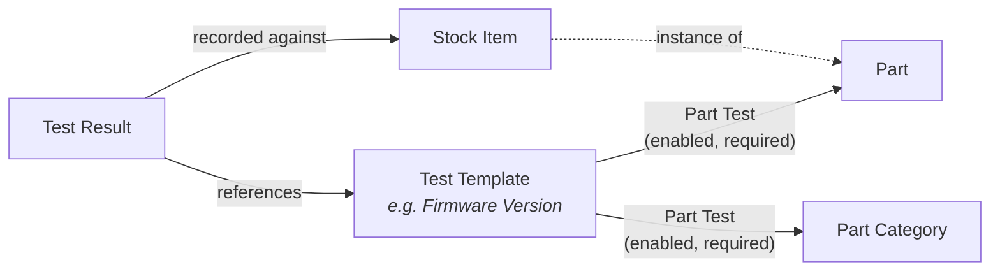

## Part Testing

InvenTree provides a framework for recording test data against individual stock items. This is particularly useful for tracking unit testing, commissioning or acceptance data against serialized stock items.

Testing is configured using three related objects:

| Object | Purpose |
| --- | --- |
| [Test Template](#test-templates) | Defines *what* a test is (name, description, value requirements). Test templates are global, and can be reused across many parts. |
| [Part Test](#part-tests) | Links a test template to a [Part](./index.md) or a [Part Category](./index.md#part-category), and defines whether the test is *enabled* and *required* for those parts. |
| [Test Result](../stock/test.md) | Records the outcome of a test against an individual [Stock Item](../stock/index.md#stock-item). |



!!! info "Testable Parts"
    Tests can only be linked to parts which are designated as [testable](./index.md#testable). Tests linked to a category only apply to the *testable* parts within that category.

## Test Templates

A *test template* defines a particular test which can be performed against stock items. Test templates are not linked to any particular part - a single template (for example *"Firmware Version"*) can be applied to any number of parts or categories via [part tests](#part-tests).

Test templates are created and managed via the *Test Templates* panel in the [Admin Center](../settings/admin.md#admin-center).

{{ image("part/test_templates_admin.png", "Test Templates") }}

### Test Template Fields

| Field | Description |
| --- | --- |
| Test Name | The name of the test. Test names must be [globally unique](#test-key). |
| Test Key | A simplified [key](#test-key) which is generated automatically from the test name |
| Description | A description of the test, displayed to the user. This is not used by the testing framework. |
| Requires Value | If set, any test result recorded against this template must provide a *value* |
| Requires Attachment | If set, any test result recorded against this template must include a file attachment |
| Choices | An optional comma-separated list of valid values. If provided, the *value* of any test result must match one of the available choices. |

### Test Key

The test name is used to generate a test *key*, which is used to match test results to templates (and to reference tests in [reports](#reporting)). The key is a simplified representation of the test name, consisting only of lowercase alphanumeric characters. It is generated automatically whenever the test template is saved.

As test templates are global, the generated key must be unique across *all* test templates. Two test names which generate the same key (e.g. *"Firmware Version"* and *"firmware version"*) cannot both exist.

The generated test key is intended to be a valid python variable name, and can be used to reference the test in the report generation system.

#### Examples

Some examples of generated test key values are provided below:

| Test Name | Test Key |
| --- | --- |
| "Firmware Version" | "firmwareversion" |
| " My NEW T E sT " | "mynewtest" |
| "100 Percent Test"| "_100percenttest" *(note that the leading underscore is added to ensure the key is a valid python variable name)* |
| "Test 123" | "test123" |

### Editing Test Templates

As a test template may be used by many parts, any changes made to a template affect *all* parts (and categories) which use that template - including [locked parts](./index.md#locked-parts). A warning is displayed in the edit form as a reminder.

{{ image("part/test_template_edit.png", "Edit Test Template") }}

If a variation of an existing test is required, use the *Duplicate* action in the *Test Templates* table to create a new template based on an existing one. The duplicated template must be given a new (unique) name.

!!! danger "Deleting Test Templates"
    Deleting a test template will also delete *all* test results recorded against that template, for every stock item. To stop a test from applying to a part, [disable the part test](#overriding-inherited-tests) instead.

## Part Tests

A *part test* links a [test template](#test-templates) to either a single **Part** or a **Part Category**. This determines which tests apply to which stock items.

### Part Test Fields

| Field | Description |
| --- | --- |
| Template | The [test template](#test-templates) to apply |
| Part | The part to which the test applies (*either a part or a category must be specified, but not both*) |
| Category | The part category to which the test applies |
| Enabled | If unset, the test is disabled for the linked part (or category). Disabled tests are not displayed when recording test results, and are not considered when determining whether a stock item has passed its required tests. |
| Required | If set, the test must be passed for a stock item to be considered as having [passed all required tests](../stock/test.md#required-tests) |

A given test template can only be linked once to any particular part, and once to any particular category.

### Linking Tests to a Part

Tests can be added to a part via the *Tests* panel on the [part detail page](./views.md#tests). A test linked to a part applies to:

- All stock items for that part
- All stock items for any [variants](./template.md) of that part (if the part is a template part)

### Linking Tests to a Category

Tests can be added to a category via the *Tests* panel on the category detail page. A test linked to a category applies to all testable parts within that category, **including parts in any subcategories**.

This is useful for defining a standard set of tests for a whole family of parts, without having to configure each part individually.

{{ image("part/category_tests.png", "Category Tests") }}

### Test Inheritance

A part *inherits* tests from multiple sources. When determining which tests apply to a given part, InvenTree considers part tests linked to (in order of precedence):

1. The part itself
2. Any template parts of which this part is a variant (closest first)
3. The category of the part
4. Any parent categories of the part's category (closest first)

If the same test template is linked at multiple levels, **only the most specific part test is used**. For example, if a test is linked to a category (as *required*) and also linked directly to a part within that category (as *not required*), then the test is *not required* for that part.

!!! note "Variant Parts and Categories"
    A variant part inherits tests from its template part(s), and from its *own* category. It does not inherit tests from the categories of its template part(s).

#### Example

Consider the following configuration:

| Linked To | Test | Enabled | Required |
| --- | --- | --- | --- |
| Category *Electronics* | Visual Inspection | Yes | Yes |
| Category *Electronics / Sensors* | Calibration | Yes | Yes |
| Part *Temperature Sensor* | Firmware Version | Yes | Yes |
| Part *Temperature Sensor* | Visual Inspection | Yes | No |

For a part *Temperature Sensor* in the category *Electronics / Sensors*, the following tests apply:

| Test | Required | Source |
| --- | --- | --- |
| Firmware Version | Yes | Linked directly to the part |
| Visual Inspection | No | Linked directly to the part (overrides the *Electronics* category) |
| Calibration | Yes | Inherited from the *Sensors* category |

### Overriding Inherited Tests

To change how an inherited test applies to a specific part (or subcategory), add a part test for the *same* template against that part (or subcategory), with the desired *enabled* and *required* values:

- To make an inherited test *optional*, add the test with *required* unset
- To exclude an inherited test entirely, add the test with *enabled* unset

The override applies to the part (and its variants), or to the subcategory (and its parts), without affecting any other parts which inherit the same test.

### Viewing Tests

The *Tests* panel on the part (or category) detail page displays all tests which apply, including inherited tests. Inherited tests are marked with an information icon which indicates where the test is defined. Inherited tests cannot be edited directly - use the row actions to navigate to the part or category where the test is defined, or [override](#overriding-inherited-tests) the test.

Use the *Include Inherited* table filter to show only the tests which are linked directly to the part (or category).

In the example below, *Test A* and *Test B* are inherited from the template part, *Visual Inspection* is inherited from the part category, and *Test C* (inherited from the template part) has been [overridden](#overriding-inherited-tests) to be optional for this part:

{{ image("part/part_tests.png", "Part Tests") }}

### Locked Parts

If [part locking](./index.md#locked-parts) is enabled, tests which are linked directly to a locked part cannot be created, edited or deleted. Tests linked to a category are not affected by part locking.

### Duplicating Parts

When duplicating a part (for example, when creating a [variant](./template.md) or a [revision](./revision.md)), the *Copy Tests* option copies all tests which are linked directly to the original part to the new part. Inherited tests are not copied, as they will be inherited by the new part anyway (if applicable).

## Test Results

Individual stock items can have test results recorded against them, which reference test templates. Refer to the [stock test result](../stock/test.md) documentation for further information.

## Reporting

Test templates which apply to a part are available in the [report context](../report/context_variables.md) for parts and stock items:

| Variable | Description |
| --- | --- |
| `test_template_list` | List of test templates which apply to the part |
| `test_templates` | Dict of test templates which apply to the part, keyed by [test key](#test-key) |

Each template in these variables also provides the `required` and `enabled` attributes of the part test which applies to the part (taking [inheritance](#test-inheritance) into account). For example:

```html


{{ template.test_name }}: RequiredOptional


```

## Upgrading from Earlier Versions

In earlier versions of InvenTree, each test template was linked directly to a single part. When upgrading, existing data is migrated automatically:

- Each existing test template is converted to a part test, linked to the same part, with the same *enabled* and *required* values
- Test templates which share the same [test key](#test-key) (across different parts) are merged into a single template:
    - The name, description and metadata of the oldest template are retained
    - *Requires Value* and *Requires Attachment* are set if they were set for *any* of the merged templates
    - *Choices* are combined from all merged templates. If any of the merged templates did not restrict choices, the merged template does not restrict choices.
    - All test results are re-linked to the merged template - no test results are lost
- Details of any merged templates are printed during the migration, so that they can be reviewed

!!! warning "API Changes"
    The `part`, `enabled` and `required` fields have been removed from the test template API endpoint (`/api/part/test-template/`). These values are now managed via the part test API endpoint (`/api/part/test/`). Any external scripts or integrations which create or modify test templates must be updated accordingly.
